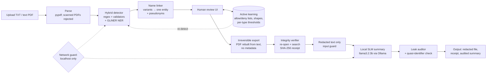
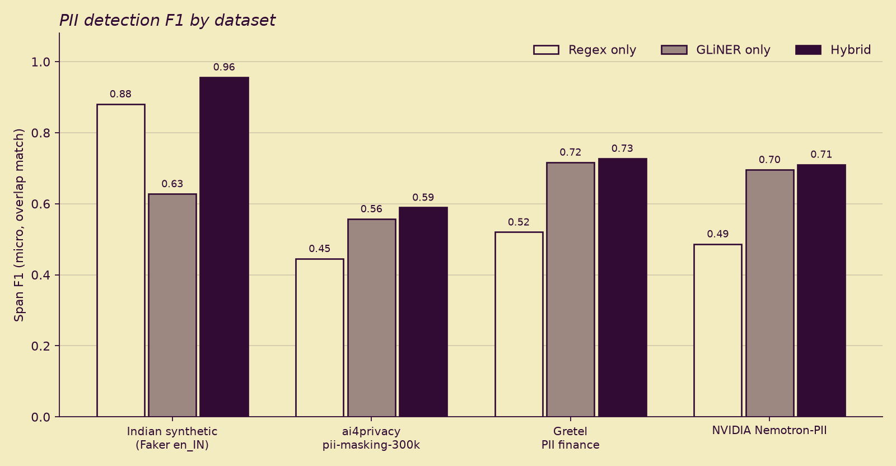

# Tinyverse Redact

**Find, review and irreversibly redact personal data in Indian business documents, then summarise them safely, entirely on your laptop.**

Tinyverse Hackathon Final Round — PS-3: Privacy-Aware Document Redaction and Summary Tool

Nikita Ravindra · USN 1MS24CI079 · CSE (AI & ML) · MSRIT

---

## The problem

HR letters, KYC forms, incident reports and vendor contracts are full of personal data: names, phone numbers, Aadhaar and PAN numbers, UPI handles, bank details and home addresses. Teams need to share and summarise these documents, but:

- generic PII tools are tuned for US and EU formats, so they miss Aadhaar, PAN and UPI, and flag order numbers and dates instead;
- "redacted" PDFs often just draw black boxes over text that is still in the file;
- sending a document to a cloud LLM for a summary leaks the very data you meant to protect;
- even with every name removed, a sentence like *"the only woman director of a Pune firm"* still identifies someone.

## What it does

1. **Detects** names, emails, phones, addresses and IDs with a hybrid of checksum-validated regex rules and a local NER model.
2. **Links** every variant of a person ("Richa Sharma", "R. Sharma", "Ms. Sharma", "Richa") into one entity with one pseudonym.
3. **Lets a human review** every candidate in a keyboard-driven UI, and **learns** from each approve or reject.
4. **Exports irreversibly**: the PDF is rebuilt from redacted text, then reopened and verified, and a SHA-256 **Redaction Receipt** is issued.
5. **Summarises only the redacted text** with a small local model, **audits the summary for leaks**, and flags **quasi-identifiers** with one-click generalisation.

## What makes it different

| | |
|---|---|
| **India-specific PII with checksums** | Aadhaar is accepted only if it passes **Verhoeff**; cards pass **Luhn**; PAN holder-type letter, IFSC structure, UPI handles, +91 / STD / 6–9 mobile formats, PIN-code addresses, obfuscated emails (`riya [at] gmail [dot] com`). Dates, ₹ amounts, SKUs, invoice and order numbers, ISBNs, versions and 12-digit numbers that fail Verhoeff are explicitly **not** PII. |
| **Irreversible export + integrity verifier** | PDFs are rebuilt from scratch with reportlab. No boxes are drawn over the original, the info dictionary is removed and no XMP is written. The exported file is **reopened**, its text extracted with pypdf, and searched for every removed string, name variant, 4+ digit run and email username. You get a **Redaction Receipt**: items removed per type, *recoverable: 0*, the file's SHA-256 and a timestamp. |
| **Redact, then summarise, with a leak auditor** | The summariser refuses input that still contains any removed value. Its output is checked by the full detector plus fuzzy checks (partial digits, usernames, surnames, initials, Levenshtein ≤ 2). Any hit triggers one stricter regeneration; anything that still leaks is replaced with its placeholder and logged. |
| **Quasi-identifier risk check** | Each sentence is scored for role + location + organisation + age/date + rare attributes, with an explanation ("Role + city + organisation type could single out one person") and a one-click **Generalise** (CFO → senior executive, Pune → a city in India). It runs on the summary and on the redacted document. |
| **Consistent pseudonyms** | `[PERSON_1]` is the same person everywhere: approve one mention and every linked variant is removed, even all-caps copies the detector never saw. |
| **Visible active learning** | Rejections become an allowlist and learned non-PII shapes; approvals become a denylist; per-type GLiNER thresholds are recalibrated within safe bounds. The "What I learned" drawer lists every rule with undo, and shows the measured precision gain. |
| **Fully local, and enforced** | A network guard patches `socket.connect` at startup and refuses and counts every non-localhost connection. The **Local only** pill shows the live counters: **outbound network calls: 0**. |

## Architecture



## How name variants are linked

`app/link.py` parses every NAME span into honorific, first name, initials and surname, then clusters them:

- **Full names** join when first name and surname match, case- and punctuation-insensitive; middle names must be compatible ("Venkatesh R. Iyer" ~ "Venkatesh Ramaswamy Iyer", but his father "Ramaswamy Iyer" stays separate).
- **Initial + surname** ("R. Sharma") joins the one person with that surname and first initial.
- **Honorific + surname** ("Ms. Sharma") joins only when exactly one gender-compatible person has that surname, so "Ms. Rao" is not confused with "Mr. Rao".
- **First name only** ("Richa") joins only when exactly one person has that first name.
- Finally the document is **rescanned for every exact occurrence of every variant** (including bare first names and surnames when unambiguous), so repeated mentions the detector missed are still covered. Each entity gets a stable pseudonym: `PERSON_1`, `EMAIL_1`, `ID_3`, …

## How the summary is checked for leaks

1. **Input guard.** The summariser only receives the redacted text. If any removed value is still present, it raises an exception rather than an `assert` that `-O` could strip.
2. **Prompt.** It tells the model to copy placeholders exactly and never guess identities.
3. **Audit.** The summary is run through the full detector, then fuzzy-matched against everything removed: 4+ digit fragments of phones and IDs, email usernames, surnames, initials ("R.S.", "Richa S."), and names within Levenshtein distance 2 ("Rihca").
4. **Repair.** Any hit triggers one regeneration with a stricter prompt. If it still leaks, the leaked text is replaced by its placeholder and logged; the log holds masked hints only.
5. **Fallback.** If Ollama is down, an extractive summary (top-scored sentences of the redacted text) is shown and labelled as such.

## Why small local models

- **Privacy by construction.** The documents never leave the machine. That is enforced by the network guard, not just promised.
- **Fast enough.** GLiNER multi-PII (~0.3 B parameters) tags a page in a fraction of a second on an M-series MacBook Air; llama3.2:3b writes an audited summary in ~6–9 s.
- **Small models are enough.** They only need to *summarise already-redacted text* and *propose candidates*. The guarantees come from deterministic code: checksums, the verifier and the auditor. A larger model would add risk and latency without adding safety.

## Results

All numbers come from `eval/run_eval.py` with a **clean detector** (learning disabled); full tables are in [eval/results.md](eval/results.md). Scores are span-level with overlap matching. Label mapping for public datasets: [eval/label_mapping.md](eval/label_mapping.md).



**Detection (micro F1)**

| Dataset | Docs | Regex only | GLiNER only | Hybrid | Hybrid P / R (%) |
|---|---:|---:|---:|---:|---|
| Indian synthetic (Faker en_IN) | 200 | 0.88 | 0.63 | 0.96 | 99.7 / 91.9 |
| ai4privacy pii-masking-300k | 500 | 0.45 | 0.56 | 0.59 | 68.4 / 51.8 |
| Gretel synthetic PII finance | 300 | 0.52 | 0.72 | 0.73 | 65.6 / 81.6 |
| NVIDIA Nemotron-PII | 300 | 0.49 | 0.70 | 0.71 | 78.4 / 65.0 |

**Other results**

| Check | Result |
|---|---|
| False positives on 1000 hard negatives (Indian set: bad-checksum 12-digit numbers, SKUs, dates, invoices, ISBNs, ₹ amounts, versions) | **0.0%** in all three configurations |
| Name-variant linking, hand-made set | **100.0%** pairwise accuracy (55/55), mention recall 100.0% |
| Summary leaks, 10 hand-made trap documents | **0** (target 0) |
| Quasi-identifier traps flagged | **3/3** (all high) |
| Audited summary time (llama3.2:3b) | 8.5 s per document |
| Peak RAM (eval process, includes GLiNER) | 2.2 GB |

**Detection speed per document** (M-series MacBook Air, CPU)

| Dataset | Regex | GLiNER | Hybrid |
|---|---:|---:|---:|
| Indian synthetic (Faker en_IN) | 0.7 ms | 0.15 s | 0.17 s |
| ai4privacy pii-masking-300k | 0.3 ms | 0.17 s | 0.20 s |
| Gretel synthetic PII finance | 1.8 ms | 0.72 s | 0.54 s |
| NVIDIA Nemotron-PII | 0.8 ms | 0.40 s | 0.46 s |

**Active learning as domain adaptation.** A simulated reviewer approves or rejects every candidate on 20 documents of a dataset using the gold labels; the learned rules are then measured on held-out documents from the same dataset.

| Dataset | Train / test docs | Approved / rejected | Precision | Recall | F1 |
|---|---|---|---|---|---|
| Indian synthetic (Faker en_IN) | 20 / 30 | 151 / 1 | 99.6 → **99.6** | 91.7 → 92.5 | 95.5 → 95.9 |
| Gretel synthetic PII finance | 20 / 100 | 49 / 34 | 63.6 → **66.7** | 86.0 → 86.0 | 73.1 → 75.1 |
| ai4privacy pii-masking-300k | 20 / 100 | 17 / 11 | 71.7 → **73.7** | 54.4 → 52.5 | 61.9 → 61.3 |

- **Gretel finance:** the reviewer rejected role words the model mistakes for people ("Lender", "Borrower", "Policyholder"). These stop being flagged in unseen finance documents: **precision 63.6% → 66.7%, with no loss of recall.** An ablation shows this comes from the learned lists; the threshold changes alone would not help. This is the number shown in the "What I learned" drawer.
- **ai4privacy:** precision rises by 2.0 points, but a raised NAME threshold costs 2.0 points of recall, so F1 is flat.
- **Indian set:** there was little to learn. The detector made only 1 false positive in the 20 training documents, so precision stays at 99.6%.

### Honest notes: why the English datasets score lower

The tool is built for Indian documents, and the Indian set is where it is strongest (hybrid F1 **0.96**). On the English/US datasets it is lower (0.59–0.73) for identifiable reasons:

- **IDs** are the biggest gap (hybrid ID recall 26.6% on ai4privacy, 24.2% on Nemotron). US SSNs, passports, driver's licences, ID cards and IBAN/BBAN numbers have no rule here; the validators cover Aadhaar, PAN, IFSC, UPI, cards and keyed IDs.
- **Names** lose precision (43.9% ai4privacy, 56.0% Gretel) because GLiNER tags roles and company names ("Lender", "High Street Bank") as people. This is exactly what the active-learning loop fixes.
- **Addresses** without Indian street cues or a 6-digit PIN rely on GLiNER alone, so recall is 45.0% on ai4privacy.
- **Hybrid is not best for every type.** On ai4privacy, GLiNER-only phone F1 (90.2%) beats hybrid (71.6%) because the Indian phone rules mis-segment some foreign numbers.
- **Some flags are unlabelled values.** Labels the datasets use but this tool does not score (dates, usernames, companies, bank routing numbers) are dropped, so some flagged values count as false positives.

## Setup (macOS, Apple silicon)

```bash
brew install ollama
brew services start ollama          # or: ollama serve
ollama pull llama3.2:3b

python3.11 -m venv .venv
source .venv/bin/activate
pip install -r requirements.txt
python -m app.fetch_model           # one-time GLiNER download (the only online step)

uvicorn app.main:app                # open http://127.0.0.1:8000
```

`python -m pytest` runs the test suite (no model or Ollama needed). Open a sample from the landing page, or deep-link to one: `http://127.0.0.1:8000/#sample=hr_offer_letter.txt`.

### Re-running the evaluation

```bash
pip install -r eval/requirements.txt
python eval/load_datasets.py        # downloads + samples the public datasets into eval/cache/ (needs internet)
python eval/make_indian_set.py      # regenerates the 200-doc Indian set (fixed seed, byte-identical)
python eval/run_eval.py             # ~17 min; writes eval/results.{md,json,png}
python eval/run_eval.py --only active-learning   # re-run just the active-learning section
python eval/run_eval.py --with-learning          # apply data/learned.json instead of a clean detector
```

## Keyboard shortcuts

| Key | Action |
|---|---|
| `A` | Approve the focused span (it will be redacted) |
| `R` | Reject the focused span (keep the text; learned) |
| `J` / `K` | Next / previous span |
| `S` | Redact all similar: the same person, or the same type and shape |
| `M` | Add a manual redaction from the selected text (`1`–`6` pick the type) |
| `E` | Export PDF (when nothing is pending) |
| `L` | Open "What I learned" |
| `?` | Shortcut sheet |
| `Esc` | Close dialogs |

## 3-minute demo script

1. **(0:00) Detection.** Open the **HR offer letter** sample, then click the **Local only** pill: GLiNER loaded, Ollama running, *outbound network calls: 0*.
2. **(0:20) What it found.** Point out Aadhaar, PAN, IFSC, the obfuscated `[at]/[dot]` email and the EMP/USN IDs. Note that `SKU-88213-B`, `12/03/2025`, ₹ amounts and `order #448812339021` are *not* flagged. The letterhead address shows as a low-confidence dashed **Org addr**.
3. **(0:45) Linking.** On the right, PERSON_1 groups "Ms. Richa Sharma", "Ms. Sharma", "R. Sharma" and a bare "Richa" the detector never tagged. Press `S` to approve the whole person.
4. **(1:05) Review and learning.** Press `J`/`A` through a few spans. Reject the letterhead address with `R`, then press `L` to show the rule it learned, with **Undo** and the measured precision gain (Gretel 63.6% → 66.7%).
5. **(1:30) Export.** Approve the rest, toggle **Pseudonym**, click **Export PDF**. The Redaction Receipt shows *0 recoverable*, removed items per type, *no metadata* and the SHA-256. Download the PDF and show that selecting text in it gives only `[PERSON_1]`.
6. **(2:10) Summary.** The summary panel shows the llama3.2:3b summary with placeholders kept, **Leak audit: passed · N checks**, and the QI risk meter.
7. **(2:35) Quasi-identifiers.** Open the **vendor contract**, export, click **Check the redacted document**: "City + company name could single out one person", then **Generalise in export**.
8. **(2:55) Close.** Show the results chart: hybrid F1 0.96 on Indian documents, 0% false positives on 1,000 hard negatives, 0 summary leaks.

## API

| Endpoint | Purpose |
|---|---|
| `POST /api/analyze` | TXT / text PDF (or pasted text) → text, spans, entities; scanned PDFs → 422 |
| `POST /api/export` | redacted TXT/PDF + Redaction Receipt (409 while spans are pending unless confirmed) |
| `POST /api/summarize` | audited summary of the redacted text + quasi-identifier report |
| `POST /api/qi` | quasi-identifier report for any text |
| `POST /api/feedback`, `GET /api/learn`, `POST /api/learn/undo`, `POST /api/learn/reset` | active learning |
| `GET /api/status` | detector mode, Ollama status, network-guard counters |

## Project layout

```
app/        main.py (API) · detect.py · link.py · redact.py · summarize.py · audit.py
            learn.py · netguard.py · config.py · fetch_model.py · fonts/ (DejaVu Sans)
static/     index.html · styles.css · app.js · fonts/ (Montserrat, Gloock)
samples/    4 synthetic Indian documents (TXT) + 1 text PDF
eval/       load_datasets.py · make_indian_set.py · run_eval.py · handmade/ · data/
            results.md · results.json · results.png · label_mapping.md
tests/      pytest suite (201 tests)
data/       learned.json (local learning store, git-ignored)
```

All sample and evaluation documents are synthetic. Every name, Aadhaar, PAN and card number is invented; some are generated to pass their checksums.

## Credits

- [GLiNER](https://github.com/urchade/GLiNER) and the `urchade/gliner_multi_pii-v1` model
- [Ollama](https://ollama.com) and Meta's [Llama 3.2](https://www.llama.com) (3B)
- Datasets: [ai4privacy/pii-masking-300k](https://huggingface.co/datasets/ai4privacy/pii-masking-300k), [gretelai/synthetic_pii_finance_multilingual](https://huggingface.co/datasets/gretelai/synthetic_pii_finance_multilingual), [nvidia/nemotron-pii](https://huggingface.co/datasets/nvidia/nemotron-pii)
- [Faker](https://faker.readthedocs.io), [FastAPI](https://fastapi.tiangolo.com), [pypdf](https://pypdf.readthedocs.io), [reportlab](https://www.reportlab.com/opensource/)
- Fonts: [DejaVu Sans](https://dejavu-fonts.github.io) (PDF export), [Montserrat](https://github.com/JulietaUla/Montserrat) and Gloock (UI), all bundled locally under their open licences

**AI assistance:** AI coding tools were used for parts of the implementation; all design decisions, evaluation and the final code were reviewed and are understood by the author.
