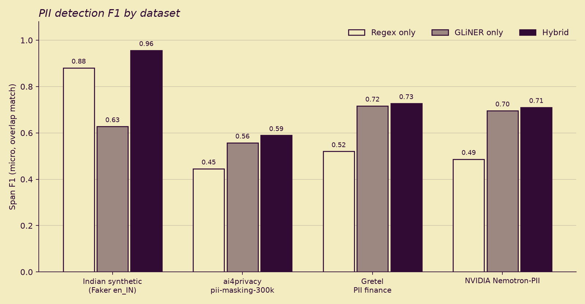

# Evaluation results

Generated 2026-11-23T15:21:30+00:00 on arm64 Darwin 25.6.0 (Python 3.11.16). Learning: **disabled (clean detector)**. Summary model: `llama3.2:3b`.

Span-level scores use overlap matching: a predicted span is correct if it overlaps a gold span of the same type; a gold span is found if any same-type prediction overlaps it. `ORG_ADDRESS` predictions count as `ADDRESS`. Label mapping: [label_mapping.md](label_mapping.md).

## Overall (micro-averaged)

| Dataset | Docs | Config | Precision | Recall | F1 | s/doc |
|---|---:|---|---:|---:|---:|---:|
| Indian synthetic (Faker en_IN) | 200 | regex | 100.0 | 78.7 | 88.1 | 0.001 |
| Indian synthetic (Faker en_IN) | 200 | gliner | 93.4 | 47.3 | 62.8 | 0.151 |
| Indian synthetic (Faker en_IN) | 200 | hybrid | 99.7 | 91.9 | 95.6 | 0.166 |
| ai4privacy pii-masking-300k | 500 | regex | 84.3 | 30.3 | 44.5 | 0.000 |
| ai4privacy pii-masking-300k | 500 | gliner | 69.3 | 46.6 | 55.7 | 0.169 |
| ai4privacy pii-masking-300k | 500 | hybrid | 68.4 | 51.8 | 58.9 | 0.196 |
| Gretel synthetic PII finance | 300 | regex | 79.1 | 38.7 | 52.0 | 0.002 |
| Gretel synthetic PII finance | 300 | gliner | 68.8 | 74.7 | 71.7 | 0.724 |
| Gretel synthetic PII finance | 300 | hybrid | 65.6 | 81.6 | 72.7 | 0.539 |
| NVIDIA Nemotron-PII | 300 | regex | 88.9 | 33.5 | 48.7 | 0.001 |
| NVIDIA Nemotron-PII | 300 | gliner | 80.9 | 61.0 | 69.6 | 0.400 |
| NVIDIA Nemotron-PII | 300 | hybrid | 78.4 | 65.0 | 71.1 | 0.461 |

## Indian synthetic (Faker en_IN): per type (P / R / F1, %)

| Type | Gold | regex | gliner | hybrid |
|---|---:|---|---|---|
| NAME | 650 | 100.0 / 53.2 / 69.5 | 98.5 / 49.4 / 65.8 | 99.0 / 79.5 / 88.2 |
| EMAIL | 150 | 100.0 / 100.0 / 100.0 | 75.0 / 100.0 / 85.7 | 100.0 / 100.0 / 100.0 |
| PHONE | 200 | 100.0 / 100.0 / 100.0 | 100.0 / 79.5 / 88.6 | 100.0 / 100.0 / 100.0 |
| ADDRESS | 150 | 100.0 / 68.0 / 81.0 | 100.0 / 100.0 / 100.0 | 100.0 / 100.0 / 100.0 |
| ID | 500 | 100.0 / 100.0 / 100.0 | – / 0.0 / – | 100.0 / 100.0 / 100.0 |

## ai4privacy pii-masking-300k: per type (P / R / F1, %)

| Type | Gold | regex | gliner | hybrid |
|---|---:|---|---|---|
| NAME | 279 | 70.1 / 19.4 / 30.3 | 45.0 / 69.2 / 54.5 | 43.9 / 69.2 / 53.7 |
| EMAIL | 160 | 94.5 / 96.9 / 95.7 | 95.8 / 98.8 / 97.2 | 94.1 / 100.0 / 97.0 |
| PHONE | 132 | 61.8 / 47.7 / 53.8 | 89.6 / 90.9 / 90.2 | 69.8 / 73.5 / 71.6 |
| ADDRESS | 249 | 97.4 / 30.9 / 46.9 | 88.9 / 29.3 / 44.1 | 90.9 / 45.0 / 60.2 |
| ID | 545 | 94.1 / 11.7 / 20.9 | 86.0 / 16.9 / 28.2 | 90.1 / 26.6 / 41.1 |

## Gretel synthetic PII finance: per type (P / R / F1, %)

| Type | Gold | regex | gliner | hybrid |
|---|---:|---|---|---|
| NAME | 492 | 72.7 / 27.6 / 40.1 | 59.6 / 81.9 / 69.0 | 56.0 / 83.5 / 67.0 |
| EMAIL | 86 | 95.5 / 97.7 / 96.6 | 100.0 / 52.3 / 68.7 | 95.5 / 97.7 / 96.6 |
| PHONE | 60 | 73.7 / 46.7 / 57.1 | 89.8 / 88.3 / 89.1 | 77.9 / 88.3 / 82.8 |
| ADDRESS | 238 | 79.7 / 46.2 / 58.5 | 82.7 / 86.1 / 84.4 | 78.0 / 90.8 / 83.9 |
| ID | 82 | 72.2 / 15.9 / 26.0 | 83.3 / 12.2 / 21.3 | 72.0 / 22.0 / 33.6 |

## NVIDIA Nemotron-PII: per type (P / R / F1, %)

| Type | Gold | regex | gliner | hybrid |
|---|---:|---|---|---|
| NAME | 226 | 91.2 / 23.0 / 36.7 | 72.0 / 83.6 / 77.4 | 72.1 / 87.6 / 79.1 |
| EMAIL | 129 | 99.2 / 100.0 / 99.6 | 99.2 / 97.7 / 98.4 | 98.5 / 100.0 / 99.2 |
| PHONE | 85 | 84.7 / 58.8 / 69.4 | 90.0 / 95.3 / 92.6 | 83.0 / 97.6 / 89.7 |
| ADDRESS | 52 | 44.4 / 30.8 / 36.4 | 61.5 / 92.3 / 73.8 | 51.0 / 98.1 / 67.1 |
| ID | 347 | 100.0 / 9.8 / 17.8 | 90.7 / 19.6 / 32.2 | 94.4 / 24.2 / 38.5 |

## Hard negatives (Indian set)

Invalid-checksum 12-digit numbers, SKUs, dates, invoice numbers, ISBNs, amounts and version numbers. False-positive rate = share of these that any predicted span touches (lower is better).

| Config | FP rate | Flagged / total | amount | date | invalid_aadhaar | invoice | isbn | sku | version |
|---|---:|---:|---:|---:|---:|---:|---:|---:|---:|
| regex | 0.0% | 0 / 1000 | 0/200 | 0/200 | 0/200 | 0/100 | 0/100 | 0/150 | 0/50 |
| gliner | 0.0% | 0 / 1000 | 0/200 | 0/200 | 0/200 | 0/100 | 0/100 | 0/150 | 0/50 |
| hybrid | 0.0% | 0 / 1000 | 0/200 | 0/200 | 0/200 | 0/100 | 0/100 | 0/150 | 0/50 |

## Name-variant linking (hand-made set, hybrid)

Pairwise accuracy: **100.0%** (55/55 mention pairs correctly placed in the same / different person). Mention recall: 100.0% (35 gold mentions).

| Doc | Correct pairs | Missed mentions |
|---|---:|---|
| 01_offer_variants | 15/15 | – |
| 02_two_sharmas | 15/15 | – |
| 03_father_and_son | 6/6 | – |
| 04_gender_conflict | 6/6 | – |
| 05_caps_header | 6/6 | – |
| 06_leak_ids | 1/1 | – |
| 07_obfuscated_contacts | 3/3 | – |
| 08_qi_woman_director | 1/1 | – |
| 09_qi_cfo_age | 1/1 | – |
| 10_qi_principal_health | 1/1 | – |

## Summary leak traps & quasi-identifier traps (hand-made set)

Summary leaks found: **0** (target 0) across 10 documents (method: llm). The leak auditor intervened on 0 document(s). Average audited summary time: 8.5s.

Quasi-identifier traps flagged (medium/high): **3/3**.

| Doc | Method | Leaks | Audit hits (1st draft) | Regenerated | Replaced | QI traps |
|---|---|---:|---:|---|---:|---|
| 01_offer_variants | llm | 0 | 0 | no | 0 | – |
| 02_two_sharmas | llm | 0 | 0 | no | 0 | – |
| 03_father_and_son | llm | 0 | 0 | no | 0 | – |
| 04_gender_conflict | llm | 0 | 0 | no | 0 | – |
| 05_caps_header | llm | 0 | 0 | no | 0 | – |
| 06_leak_ids | llm | 0 | 0 | no | 0 | – |
| 07_obfuscated_contacts | llm | 0 | 0 | no | 0 | – |
| 08_qi_woman_director | llm | 0 | 0 | no | 0 | high |
| 09_qi_cfo_age | llm | 0 | 0 | no | 0 | high |
| 10_qi_principal_health | llm | 0 | 0 | no | 0 | high |

## Active learning as domain adaptation (simulated reviewer)

Protocol: on the first 20 documents of a dataset, a simulated reviewer approves or rejects every hybrid candidate using the gold labels, as a careful human would in the UI: a candidate that overlaps any gold PII span is approved (even if its type label is off, since it must be redacted either way), and anything else is rejected. The learned rules (allowlist, denylist, non-PII shapes, candidate rules, per-type GLiNER thresholds) are then applied to **held-out documents from the same dataset** and compared with the clean detector. No decoys were added to any dataset.

| Dataset | Train / test docs | Reviewer feedback | Rules learned | Precision | Recall | F1 | False positives |
|---|---:|---|---:|---|---|---|---|
| Indian synthetic (Faker en_IN) | 20 / 30 | 151 approved, 1 rejected | 149 | 99.6 → 99.6 | 91.7 → 92.5 | 95.5 → 95.9 | 1 → 1 |
| Gretel synthetic PII finance | 20 / 100 | 49 approved, 34 rejected | 56 | 63.6 → 66.7 | 86.0 → 86.0 | 73.1 → 75.1 | 158 → 138 |
| ai4privacy pii-masking-300k | 20 / 100 | 17 approved, 11 rejected | 26 | 71.7 → 73.7 | 54.4 → 52.5 | 61.9 → 61.3 | 65 → 57 |

What was learned and why the results differ:

- **Indian synthetic (Faker en_IN)**: There was little to learn: the clean detector made only 1 false-positive candidate(s) in 20 documents, so the reviewer had almost nothing to reject. Precision was already 99.6%; the small recall change comes from approved strings (denylist) and lower GLiNER thresholds. Thresholds after learning: {'ADDRESS': 0.253, 'EMAIL': 0.253, 'ID': 0.45, 'NAME': 0.25, 'PHONE': 0.25}.
- **Gretel synthetic PII finance**: The reviewer rejected 34 false positives (by type: NAME 28, ADDRESS 5, ID 1); learned non-PII shapes: none (rejected values were mostly words, and only digit-bearing codes become shapes). On 100 unseen documents precision moved +3.1 points and recall +0.0. Ablation: lists alone +4.1 precision points, thresholds alone -1.0 precision / +0.0 recall points, so the change is driven mainly by the allow/deny lists. Rejected strings include “High Street Bank”, “Lender”, “Borrower”, “Davenport-Terry”, “West Tammybury, 11988 UK”, “Policyholder”: mostly role and domain words the model mistakes for names, which then stop being flagged in new documents of the same kind. Thresholds after learning: {'ADDRESS': 0.358, 'EMAIL': 0.343, 'ID': 0.45, 'NAME': 0.45, 'PHONE': 0.311}.
- **ai4privacy pii-masking-300k**: The reviewer rejected 11 false positives (by type: NAME 10, ADDRESS 1); learned non-PII shapes: none (rejected values were mostly words, and only digit-bearing codes become shapes). On 100 unseen documents precision moved +2.0 points and recall -2.0. Ablation: lists alone +1.3 precision points, thresholds alone +0.7 precision / -2.0 recall points, so the change is driven mainly by the allow/deny lists. Rejected strings include “Campus Safety Officer”, “Platform owner”, “Users”, “Counselor”, “Client”, “Team”: mostly role and domain words the model mistakes for names, which then stop being flagged in new documents of the same kind. Thresholds after learning: {'ADDRESS': 0.5, 'EMAIL': 0.291, 'ID': 0.311, 'NAME': 0.553, 'PHONE': 0.4}.

The review UI's “What I learned” drawer shows the largest honest precision change: **Gretel synthetic PII finance, 63.6% → 66.7%**.

## Resources

- Peak RAM (whole run, includes the GLiNER model): **2209 MB**
- Total runtime: 16.7 min
